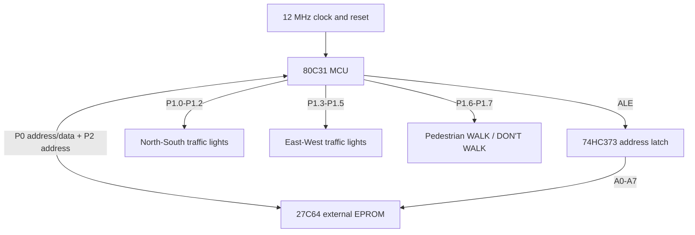
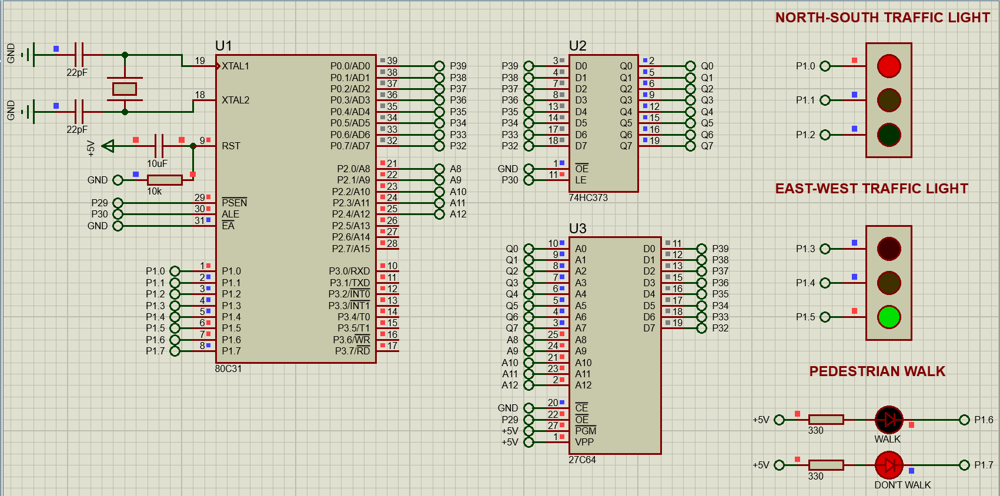
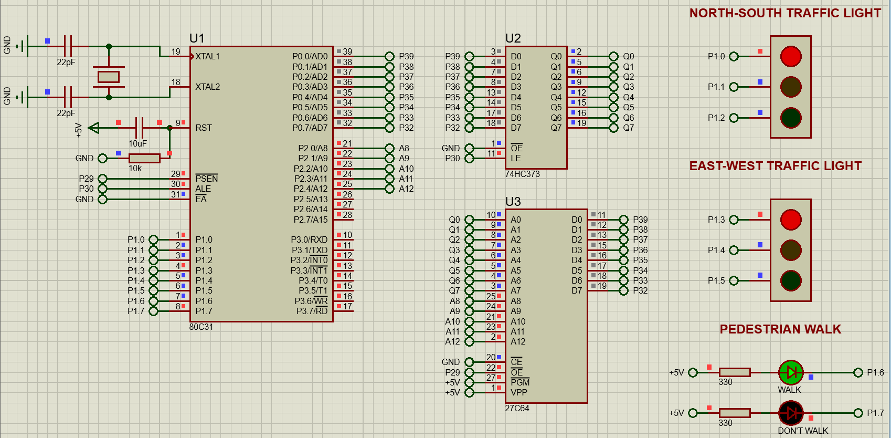
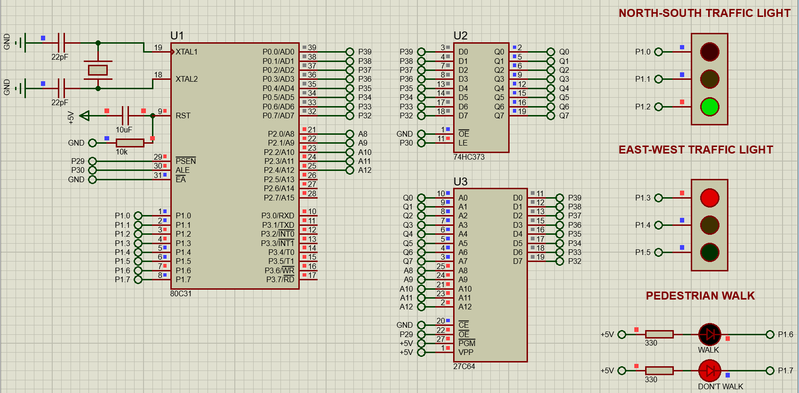

# 80C31 Smart Traffic Light & Pedestrian Crossing Controller

**Proteus 8 · 80C31 / 8051 family · ASEM-51 assembly · External EPROM · 12 MHz**

An educational **two-direction traffic-light and automatic pedestrian-crossing controller** built around the ROMless **Intel-compatible 80C31**. The Proteus simulation uses a **74HC373 address latch** and **27C64 external program EPROM** to execute assembly firmware. North–South and East–West vehicle signals alternate with all-red safety intervals and a timed pedestrian WALK phase.

> **Project status:** The submitted Proteus screenshots show the East–West green, pedestrian WALK, and North–South green phases. The uploaded `.pdsprj` includes both the exact firmware source and a built HEX. Screenshots show observed simulation states; they are **not** a complete independent timing, hardware, or safety validation.

## Features

- Two road directions, each with **red, yellow and green** outputs
- **All-red intervals** between conflicting vehicle phases
- Automatic pedestrian **WALK / DON'T WALK** indicators
- **Timer 0**, 16-bit, for approximately 50 ms timing ticks
- External **27C64 EPROM** and **74HC373** address/data bus interface
- Source assembly, existing compiled HEX, original Proteus project and three genuine simulation screenshots included

**Scope:** The pedestrian WALK phase occurs automatically every cycle. A pedestrian-request button, vehicle sensors, adaptive timing and an industrial driver stage are **not implemented** in this version.

## Short block diagram



*Logical overview only. In the schematic, Port 0 shares the EPROM data bus, while the latch holds the lower address byte.*

## Main components

| Component | Purpose |
|---|---|
| 80C31 | 8-bit traffic-signal controller with external program memory |
| 74HC373 | Latches the lower address byte A0–A7 from multiplexed P0 |
| 27C64 (8 KB) | Stores 80C31 program instructions |
| 12 MHz crystal, two 22 pF capacitors | Microcontroller oscillator |
| 10 µF capacitor + 10 kΩ resistor | Power-on reset network |
| Two traffic-light indicators | North–South and East–West signal heads |
| Two pedestrian LEDs | WALK and DON'T WALK (active LOW in this circuit) |
| 330 Ω resistors (simulation) | Pedestrian LED current-limiting elements |

## Port 1 assignments

| Port 1 bit | Physical 80C31 pin | Assigned indicator | Logic in current simulation |
|---|---:|---|---|
| P1.0 | 1 | North–South RED | HIGH = ON |
| P1.1 | 2 | North–South YELLOW | HIGH = ON |
| P1.2 | 3 | North–South GREEN | HIGH = ON |
| P1.3 | 4 | East–West RED | HIGH = ON |
| P1.4 | 5 | East–West YELLOW | HIGH = ON |
| P1.5 | 6 | East–West GREEN | HIGH = ON |
| P1.6 | 7 | Pedestrian WALK | LOW = ON |
| P1.7 | 8 | Pedestrian DON'T WALK | LOW = ON |

**Why the pedestrian signals are active LOW:** The discrete LEDs are wired between +5 V (via resistors) and the microcontroller output; pulling that output LOW sinks current. The road-traffic modules behave as active-HIGH inputs in the captured simulation.

## Automatic sequence

The assembly program runs through the following phases after an initial all-red interval of approximately 2 seconds:

| Phase | North–South | East–West | Pedestrian | P1 output | Programmed duration |
|---|---|---|---|---|---:|
| 1 | Green | Red | DON'T WALK | `4CH` | ~5 s |
| 2 | Yellow | Red | DON'T WALK | `4AH` | ~2 s |
| 3 | Red | Red | DON'T WALK | `49H` | ~1 s |
| 4 | Red | Green | DON'T WALK | `61H` | ~5 s |
| 5 | Red | Yellow | DON'T WALK | `51H` | ~3 s |
| 6 | Red | Red | DON'T WALK | `49H` | ~1 s |
| 7 | Red | Red | WALK | `89H` | ~4 s |
| 8 | Red | Red | DON'T WALK | `49H` | ~2 s |

A full repeating sequence is approximately **23 seconds**, excluding instruction and simulation overhead. The clock and Timer 0 configuration assume a classic **12-clock 8051 at 12 MHz**; these durations are nominal, not stopwatch-verified.

### Key timing detail

The program initializes **Timer 0 in 16-bit Mode 1** and loads `TH0 = 3CH`, `TL0 = B0H`. At a nominal 1 MHz timer input this gives 50,000 timer counts (about 50 ms). It repeats these waits to form approximately one-second intervals.

### East–West yellow correction

The final source includes **`MOV P1,#051H`**, which sets P1.4 HIGH for the East–West yellow phase. This was the output that was separately tested during troubleshooting. The original final source and compiled HEX are included unchanged.

## Simulation screenshots

These are the **three screenshots supplied with this project**. They depict individual operating states, not a timed continuous capture.

### East–West green, North–South red



### Pedestrian WALK with both road directions red



### North–South green, East–West red



## Repository structure

```text
80C31-Smart-Traffic-Light-Pedestrian-Crossing-Controller/
├── README.md
├── LICENSE
├── .gitignore
├── Firmware/
│   ├── main.asm                    # Exact embedded ASEM-51 source
│   ├── main.txt                    # Identical editable text copy
│   └── Debug.HEX                   # Exact built HEX embedded in project
├── Proteus/
│   └── 80C31 Smart Traffic Light & Pedestrian Crossing Controller.pdsprj
├── Images/
│   ├── 01_east_west_green_north_south_red.png
│   ├── 02_pedestrian_walk_all_red.png
│   └── 03_north_south_green_east_west_red.png
└── Documentation/
    ├── CONNECTIONS.md
    ├── TESTING_AND_LIMITATIONS.md
    └── GITHUB_SETUP.md
```

## How to open and simulate

1. Open the `.pdsprj` file in **Proteus 8** with the required component models installed.
2. The project includes a VSM Studio **ASEM-51** firmware project. `Firmware/main.asm` is an identical external copy of the source embedded in the supplied project.
3. Use the included compiled `Firmware/Debug.HEX` with the external **27C64 EPROM** if the Proteus project requires you to reselect the program file. Rebuild with ASEM-51 if you change the `.asm` file.
4. Confirm the **80C31 clock is 12 MHz**, `/EA` is tied LOW, the 74HC373 `/OE` is LOW, and the EPROM is enabled for read mode.
5. Run the simulation. Observe the sequence of North–South green/yellow, all-red, East–West green/yellow, and pedestrian WALK.
6. Use a **logic analyser** or oscilloscope to record P1.0–P1.7 and confirm signal duration if quantitative evidence is required.

For the detailed pin connections and recommended checks, see [CONNECTIONS.md](Documentation/CONNECTIONS.md) and [TESTING_AND_LIMITATIONS.md](Documentation/TESTING_AND_LIMITATIONS.md).

## Limitations and safety

- The three images show selected simulated states; a full automated end-to-end timing test is not included.
- Pedestrian phases are **automatic**, not triggered by a push button.
- Current 330 Ω pedestrian LED connections are shown as simulated. Classic 8051 GPIO current limits should be checked and **suitable transistor/driver stages** used for real lamps or physically bright LEDs.
- Real road-signal control needs fail-safe hardware, conflict monitoring, watchdogs, protected supplies, approved switching hardware and regulatory review. **This is an academic simulation, not deployable traffic-control equipment.**

## Future improvements

- Pedestrian call button at P3.2/INT0 with request latching
- Timer interrupts instead of blocking polling delays
- Amber flashing / pedestrian countdown indicator
- Vehicle detection, adaptive phase selection, and fail-safe all-red behavior
- Automated logic-analyser timing traces and test table
- PCB implementation with suitable protected lamp drivers

## Author

**L.N. Sehlabane** — Electrical Engineering / Embedded Systems

## License

MIT License for the original author-created files included here. Proteus, chip models, third-party libraries and other software remain subject to their own licenses.
